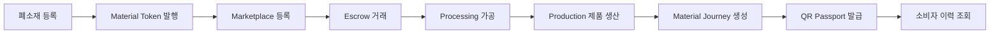
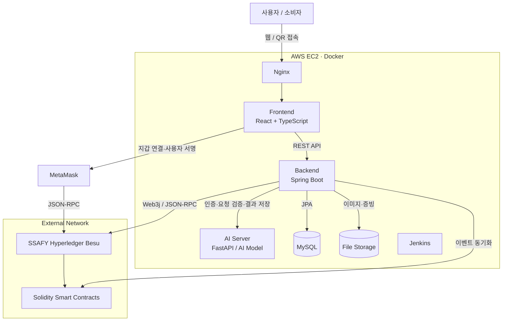
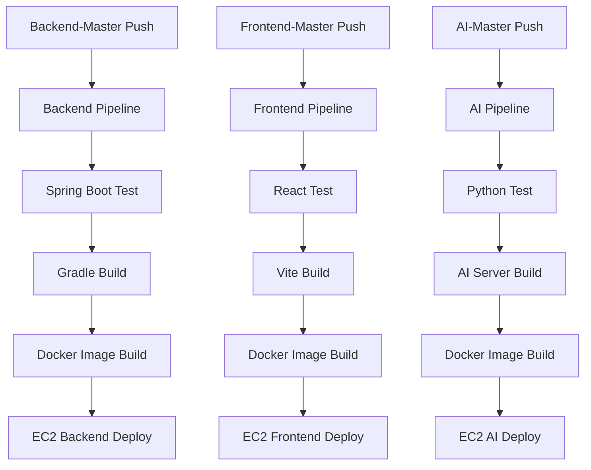
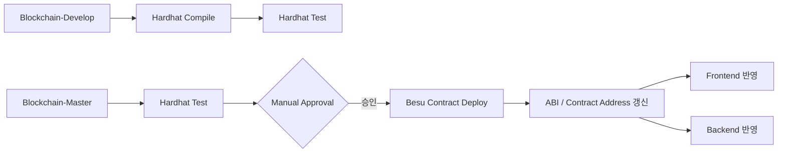

# 순환 패션 블록체인 플랫폼

> 폐소재가 새로운 제품으로 재탄생하는 전 과정을 블록체인으로 기록하고, 누구나 QR 코드로 소재의 여정을 확인할 수 있는 순환 패션 플랫폼입니다.

## 1. 프로젝트 소개

패션 산업의 폐기물 문제를 해결하려면 폐소재의 수거부터 가공, 제품 생산, 판매까지 이어지는 이력을 신뢰할 수 있어야 합니다. 그러나 기존 시스템에서는 단계별 데이터가 분산되어 있고, 친환경·재활용 정보가 실제 이력인지 검증하기 어렵습니다.
이 프로젝트는 폐소재를 등록하면서 **Material Token**을 발행하고, 소재의 거래와 가공·생산 이력을 **Hyperledger Besu** 기반 블록체인에 기록합니다. 완성 제품에는 **QR Passport**를 연결하여 소비자가 원재료의 출처와 전체 Material Journey를 직접 확인할 수 있도록 합니다.

### 핵심 목표

- 폐소재의 등록부터 완제품 생산까지 추적 가능한 이력 제공
- Material Token을 이용한 소재 소유권 및 상태 관리
- Marketplace와 Escrow를 통한 안전한 소재 거래
- 위·변조가 어려운 가공·생산 증빙 기록
- QR Passport를 통한 소비자 중심의 투명한 정보 공개
- 블록체인과 관계형 데이터베이스의 역할을 분리한 실용적 하이브리드 구조

## 2. 서비스 흐름



1. 공급자가 폐원단·재고 원단 등 폐소재와 증빙 자료를 등록합니다.
2. 검증된 소재에 고유한 Material Token을 발행합니다.
3. 소유자가 소재를 Marketplace에 판매 등록합니다.
4. 구매 대금은 Escrow에 예치되고 거래 조건 충족 후 정산됩니다.
5. 가공업체가 세척, 분쇄, 방적, 염색 등 Processing 이력을 기록합니다.
6. 제조업체가 가공 소재를 제품에 투입하고 Production 이력을 생성합니다.
7. 원소재부터 완제품까지의 연결 관계를 Material Journey로 구성합니다.
8. 제품별 QR Passport를 발급하고 소비자에게 검증 가능한 이력을 제공합니다.

## 3. 주요 기능

| 도메인 | 주요 기능 |
| --- | --- |
| User / Wallet | 회원가입, 로그인, 역할 관리, 지갑 연결, 지갑 주소 검증 |
| Material | 폐소재 등록·조회·검증, 증빙 업로드, Material Token 발행 및 상태 관리 |
| Marketplace / Trade | 판매 등록, 검색·필터링, 구매 요청, 거래 상태 및 소유권 관리 |
| Escrow | 구매 대금 예치, 거래 승인, 정산, 취소·분쟁 상태 관리 |
| Processing | 가공 공정 등록, 투입·산출 소재 연결, 공정 증빙 및 상태 기록 |
| Production | 제품 생산 등록, 사용 소재와 수량 연결, 제품 이력 생성 |
| Traceability | Material Journey 조회, 온체인 트랜잭션 검증, 단계별 타임라인 제공 |
| QR Passport | 제품별 QR 생성, 공개 이력 페이지, 원산지·가공·생산 정보 확인 |

## 4. 기술 스택

### Frontend

- **React + TypeScript**: 컴포넌트 기반 UI와 명확한 타입 계약을 이용한 협업
- **Vite**: 빠른 개발 서버와 간결한 빌드 환경
- **ethers.js**: MetaMask 연결, 서명 요청, 스마트 컨트랙트 호출 및 이벤트 조회
- **MetaMask**: 사용자 지갑 연결과 거래 서명

### Backend

- **Java + Spring Boot**: REST API, 인증·인가, 비즈니스 로직 및 트랜잭션 처리
- **Web3j**: 백엔드의 Besu RPC 통신, 컨트랙트 호출, 이벤트 수집
- **MySQL**: 사용자, 검색용 데이터, 파일 메타데이터, 서비스 상태 저장

### AI

- **Python + FastAPI**: Backend와 분리된 AI 추론 API 제공
- **AI Model**: 소재·제품 관련 분석 등 모델 추론을 전담하며, 인증과 결과 저장은 Spring Boot가 담당

### Blockchain

- **Hyperledger Besu**: SSAFY에서 제공하는 EVM 호환 블록체인 네트워크
- **Solidity**: Material Token, Marketplace, Escrow, Journey 관련 스마트 컨트랙트 구현
- **Hardhat**: 컨트랙트 컴파일, 테스트, 배포 및 ABI 관리

### Infrastructure / DevOps

- **AWS EC2**: 애플리케이션 실행 환경
- **Docker / Docker Compose**: 서비스별 실행 환경 표준화
- **Nginx**: 정적 파일 제공, HTTPS 종료, API 리버스 프록시
- **Jenkins**: 빌드·테스트·배포 자동화

## 5. 기술 선택 이유

| 기술 | 선택 이유 |
| --- | --- |
| React + TypeScript | 기능 도메인별 병렬 개발에 적합하고, Web3 관련 예제와 라이브러리가 풍부하며 타입으로 컴포넌트·API 계약을 명확히 관리할 수 있습니다. |
| Spring Boot | 계층형 구조, 보안, 데이터 접근, 트랜잭션 관리 생태계가 안정적이며 Java 기반 팀 개발에 적합합니다. |
| FastAPI | Python 기반 AI 모델을 독립 서비스로 구성하기 쉽고, 가벼운 추론 API를 빠르게 구현할 수 있습니다. |
| MySQL | 목록 검색과 통계, 사용자·권한, 서비스 상태처럼 관계와 조회 성능이 중요한 데이터를 효율적으로 처리합니다. |
| Hyperledger Besu | EVM 및 Solidity와 호환되고 허가형 네트워크 구성이 가능해 참여 주체가 명확한 공급망 서비스에 적합합니다. |
| ethers.js / MetaMask | 브라우저에서 지갑 연결, 사용자 서명, 컨트랙트 상호작용을 표준적인 방식으로 구현할 수 있습니다. |
| Web3j | Spring Boot에서 블록체인 트랜잭션과 이벤트를 Java 객체 중심으로 다룰 수 있습니다. |
| Hardhat | 컨트랙트 테스트와 배포 자동화, 네트워크별 설정 및 ABI 산출물 관리가 편리합니다. |
| Docker / Jenkins | 개발·운영 환경 차이를 줄이고 반복 가능한 CI/CD 파이프라인을 구축할 수 있습니다. |

## 6. 블록체인 적용 범위

모든 데이터를 블록체인에 저장하지 않고, **신뢰와 검증이 필요한 핵심 사실은 온체인**, 검색·화면 표시·운영에 필요한 상세 정보는 **오프체인**에 저장합니다.

### 온체인 데이터

- Material Token ID, 소유자, 상태 및 수량
- 소재 발행·이전·소각 이력
- Marketplace 판매 및 거래 상태
- Escrow 예치·승인·정산·취소 상태
- Processing의 투입 소재와 산출 소재 연결 관계
- Production의 제품과 사용 소재 연결 관계
- 증빙 원본을 검증하기 위한 해시
- 주요 상태 변경 이벤트와 타임스탬프

### 오프체인 데이터

- 사용자 프로필, 권한 및 인증 정보
- 소재·제품 설명, 검색 조건, 이미지와 문서
- 화면 표시를 위한 조회 모델과 통계
- 트랜잭션 처리 상태, 재시도 정보, 이벤트 인덱싱 결과
- QR Passport 공개 페이지용 캐시 데이터

> 이미지와 문서 원본은 별도 파일 저장소에 보관하고, 해당 파일의 해시만 블록체인에 기록하여 무결성을 검증합니다.

### 스마트 컨트랙트 구성 예시

| 컨트랙트 | 책임 |
| --- | --- |
| `MaterialToken` | 소재 토큰 발행, 소유권 이전, 수량·상태 관리 |
| `Marketplace` | 판매 등록, 구매 요청, 거래 상태 관리 |
| `Escrow` | 대금 예치, 거래 승인, 정산 및 취소 |
| `ProcessRegistry` | 가공 공정과 투입·산출 소재 관계 기록 |
| `ProductionRegistry` | 제품 생산과 사용 소재 관계 기록 |
| `JourneyRegistry` | 제품 중심의 Material Journey 기준점과 증빙 해시 관리 |

## 7. 시스템 아키텍처



일반 서비스 요청은 `사용자 → Nginx → React → Spring Boot` 순서로 처리됩니다. AI 기능도 Frontend가 AI Server를 직접 호출하지 않고 `Frontend → Spring Boot → AI Server`를 따릅니다. Spring Boot는 인증, 요청 검증, 비즈니스 로직과 결과 저장을 담당하고 AI Server는 모델 추론에 집중합니다. 사용자 서명이 필요한 블록체인 작업은 별도로 `React → MetaMask → Besu` 흐름을 사용합니다.

### 트랜잭션 처리 원칙

- 사용자의 명시적 동의가 필요한 소유권 이전과 거래는 MetaMask 서명을 우선합니다.
- 서버가 수행해야 하는 운영 트랜잭션은 권한이 제한된 별도 계정을 사용합니다.
- 백엔드는 트랜잭션 해시를 저장하고, receipt 확인 후 최종 상태를 반영합니다.
- 컨트랙트 이벤트를 수집해 MySQL 조회 모델을 갱신합니다.
- 온체인과 오프체인의 일시적 불일치를 고려해 `PENDING`, `CONFIRMED`, `FAILED` 상태를 구분합니다.
- 개인키와 비밀값은 저장소에 커밋하지 않고 Jenkins Credentials 또는 운영 환경의 Secret으로 관리합니다.

## 8. 저장소 및 프로젝트 구조

프로젝트는 Git Repository를 여러 개로 나누지 않습니다. **하나의 `Circular-Fashion` Repository 안에서 영역별 Master / Develop 브랜치를 독립 프로젝트처럼 운영**합니다. 각 Master 브랜치는 서로 다른 프로젝트 루트를 가지며, 다른 영역의 Master 또는 Develop 브랜치와 직접 Merge하지 않습니다.

```text
Circular-Fashion Repository
│
├── Backend-Master
│   └── Backend-Develop
│       └── backend/feature/*
│
├── Frontend-Master
│   └── Frontend-Develop
│       └── frontend/feature/*
│
├── Blockchain-Master
│   └── Blockchain-Develop
│       └── blockchain/feature/*
│
├── AI-Master
│   └── AI-Develop
│       └── ai/feature/*
│
└── Deploy-Master
```

| 브랜치 | 관리 대상 |
| --- | --- |
| `Backend-Master` | Spring Boot 애플리케이션 |
| `Frontend-Master` | React 웹 애플리케이션 |
| `Blockchain-Master` | Solidity 스마트 컨트랙트, ABI, 배포 주소 |
| `AI-Master` | FastAPI 기반 AI 추론 서비스 |
| `Deploy-Master` | Docker Compose, Nginx, Jenkins Pipeline, 배포 스크립트 |

### Backend-Master

Spring Boot 프로젝트 루트를 관리합니다.

```text
.
├── src/
│   ├── main/
│   │   ├── java/
│   │   │   └── .../
│   │   │       ├── user/
│   │   │       ├── material/
│   │   │       ├── trade/
│   │   │       ├── processing/
│   │   │       ├── production/
│   │   │       ├── traceability/
│   │   │       └── common/
│   │   └── resources/
│   └── test/
├── build.gradle
├── settings.gradle
├── Dockerfile
└── README.md
```

### Frontend-Master

React + TypeScript + Vite 프로젝트 루트를 관리합니다.

```text
.
├── src/
│   ├── components/
│   ├── features/
│   ├── pages/
│   ├── hooks/
│   ├── services/
│   ├── types/
│   └── utils/
├── public/
├── package.json
├── tsconfig.json
├── vite.config.ts
├── Dockerfile
└── README.md
```

### Blockchain-Master

Solidity + Hardhat 프로젝트와 다음 스마트 컨트랙트를 관리합니다.

```text
.
├── contracts/
│   ├── MaterialToken.sol
│   ├── Marketplace.sol
│   ├── Escrow.sol
│   ├── ProcessRegistry.sol
│   ├── ProductionRegistry.sol
│   └── JourneyRegistry.sol
├── scripts/
├── test/
├── deployments/
├── abi/
├── hardhat.config.ts
├── package.json
└── README.md
```

스마트 컨트랙트 ABI와 배포된 Contract Address의 **Source of Truth는 `Blockchain-Master`**입니다. 공통 패키지에 복제해 관리하지 않고, 검증된 산출물을 Frontend와 Backend에 배포하거나 전달합니다.

```text
Blockchain-Master
│
├── ABI / Contract Address → Frontend-Master
│
└── ABI / Contract Address → Backend-Master
```

ABI 또는 주소가 변경되면 버전과 대상 네트워크를 함께 기록하고, Frontend와 Backend가 같은 배포 버전을 참조하는지 확인합니다.

### AI-Master

Backend와 분리된 Python + FastAPI 기반 AI 추론 서비스를 관리합니다.

```text
.
├── app/
│   ├── api/
│   ├── services/
│   ├── models/
│   ├── schemas/
│   └── main.py
├── model/
├── tests/
├── requirements.txt
├── Dockerfile
└── README.md
```

AI Server는 외부 클라이언트의 인증이나 서비스 데이터를 직접 책임지지 않습니다. 요청 흐름은 `Frontend → Spring Boot → AI Server`이며, Spring Boot가 인증, 입력 검증, 비즈니스 로직과 결과 저장을 담당합니다.

### Deploy-Master

별도의 Infra-Master / Infra-Develop 브랜치는 두지 않습니다. `Deploy-Master` 하나에서 각 서비스를 실제 서버에 조합하고 배포하기 위한 공통 설정을 관리합니다.

```text
.
├── docker-compose.yml
├── nginx/
│   └── nginx.conf
├── jenkins/
│   ├── backend.Jenkinsfile
│   ├── frontend.Jenkinsfile
│   ├── ai.Jenkinsfile
│   └── blockchain.Jenkinsfile
├── scripts/
│   ├── deploy-backend.sh
│   ├── deploy-frontend.sh
│   ├── deploy-ai.sh
│   └── health-check.sh
└── README.md
```

애플리케이션 이미지 빌드에 필요한 `Dockerfile`은 각각 `Backend-Master`, `Frontend-Master`, `AI-Master`에서 관리합니다. `Deploy-Master`는 Docker Compose, Nginx, Jenkins Pipeline과 배포 스크립트를 통해 해당 이미지의 실행·연결·배포 방식을 관리합니다.

## 9. 기능 도메인별 역할 분담

팀 규모와 일정에 맞게 한 사람이 하나의 도메인을 주도하되, 공통 규격과 핵심 컨트랙트는 함께 리뷰합니다.

| 담당 | 주도 도메인 | 주요 작업 |
| --- | --- | --- |
| 팀원 1 | User / Wallet | 인증·인가, 역할 관리, MetaMask 연결, 지갑 주소 검증 |
| 팀원 2 | Material | 폐소재 등록·검증, 증빙 관리, Material Token 발행 |
| 팀원 3 | Marketplace / Escrow | 판매·구매 흐름, 거래 상태, Escrow 컨트랙트 연동 |
| 팀원 4 | Processing | 가공 공정, 투입·산출 소재 관계, 증빙 해시 기록 |
| 팀원 5 | Production | 제품 생산, 소재 투입량, 제품과 소재 연결 |
| 팀원 6 | Traceability / QR | Material Journey, QR Passport, 공개 조회 화면 |

### 공동 책임

- API 명세, 데이터 모델, 이벤트 명명 규칙 합의
- 스마트 컨트랙트 권한·보안·가스 비용 리뷰
- 공통 UI 컴포넌트와 타입 정의 관리
- 온체인 이벤트와 오프체인 상태 동기화 정책 관리
- 코드 리뷰, 통합 테스트, 배포 및 장애 대응

## 10. 브랜치 및 협업 전략

### 10.1 전체 브랜치 구조

본 프로젝트는 Backend, Frontend, AI, Blockchain 파트를 독립적으로 개발하며,
각 파트마다 `master`, `develop`, `feat/*` 브랜치를 운영합니다.

```text
master

backend/master
└── backend/develop
    └── backend/feat/*

frontend/master
└── frontend/develop
    └── frontend/feat/*

ai/master
└── ai/develop
    └── ai/feat/*

blockchain/master
└── blockchain/develop
    └── blockchain/feat/*

deploy/master
```

최상위 `master`는 프로젝트 전체 기준 브랜치로 유지합니다.

일반적인 개발 과정에서는 Backend, Frontend, AI, Blockchain의 작업 내용을
최상위 `master`에 계속 병합하지 않습니다.

각 파트는 자신의 `master`와 `develop`을 기준으로 독립적으로 개발합니다.

---

### 10.2 브랜치 역할

#### master

프로젝트 전체의 기준 브랜치입니다.

- 저장소 최초 기준 브랜치
- 일반적인 기능 개발에서는 직접 사용하지 않음

---

#### backend/master

Backend의 안정 버전 브랜치입니다.

```text
backend/feat/*
↓
backend/develop
↓
backend/master
```

역할:

- Backend의 안정된 코드 유지
- 배포 또는 시연 가능한 Backend 버전 관리
- `backend/develop`에서 충분한 테스트가 완료된 경우에만 병합
- 일반 기능 개발을 직접 진행하지 않음

---

#### backend/develop

Backend의 개발 통합 브랜치입니다.

Backend 기능 브랜치는 항상 `backend/develop`에서 생성하며,
완료된 기능은 다시 `backend/develop`로 Pull Request를 생성합니다.

---

#### frontend/master

Frontend의 안정 버전 브랜치입니다.

```text
frontend/feat/*
↓
frontend/develop
↓
frontend/master
```

역할:

- Frontend의 안정된 코드 유지
- 시연 및 배포 가능한 Frontend 버전 관리
- `frontend/develop`에서 검증된 코드만 병합

---

#### frontend/develop

Frontend의 개발 통합 브랜치입니다.

---

#### ai/master

AI 파트의 안정 버전 브랜치입니다.

```text
ai/feat/*
↓
ai/develop
↓
ai/master
```

역할:

- 검증된 AI 코드 유지
- 안정된 모델 및 추론 서버 버전 관리
- `ai/develop`에서 테스트가 완료된 코드만 병합

---

#### ai/develop

AI 기능의 개발 통합 브랜치입니다.

---

#### blockchain/master

Blockchain 파트의 안정 버전 브랜치입니다.

```text
blockchain/feat/*
↓
blockchain/develop
↓
blockchain/master
```

역할:

- 검증된 Smart Contract 및 Blockchain 코드 유지
- 배포 가능한 Contract 버전 관리
- `blockchain/develop`에서 충분히 검증된 코드만 병합

---

#### blockchain/develop

Blockchain 기능의 개발 통합 브랜치입니다.

---

#### deploy/master

배포 관련 설정과 운영 배포 구성을 관리하는 브랜치입니다.

역할:

- 배포 설정 관리
- Docker / Docker Compose 설정
- CI/CD 설정
- Nginx 및 Reverse Proxy 설정
- 운영 환경 설정
- 배포 스크립트 관리

`deploy/master`는 별도의 `develop` 또는 `feat/*` 브랜치를 두지 않습니다.

배포 관련 변경은 `deploy/master`에서 직접 관리합니다.

---

### 10.3 최초 브랜치 생성

원격 저장소의 기본 브랜치가 `master`라고 가정합니다.

먼저 최신 `master`를 가져옵니다.

```bash
git checkout master
git pull origin master
```

---

#### Backend 브랜치 생성

```bash
git checkout master
git checkout -b backend/master
git push -u origin backend/master
git checkout -b backend/develop
git push -u origin backend/develop
```

`backend/develop`은 `backend/master`에서 생성됩니다.

---

#### Frontend 브랜치 생성

```bash
git checkout master
git checkout -b frontend/master
git push -u origin frontend/master
git checkout -b frontend/develop
git push -u origin frontend/develop
```

---

#### AI 브랜치 생성

```bash
git checkout master
git checkout -b ai/master
git push -u origin ai/master
git checkout -b ai/develop
git push -u origin ai/develop
```

---

#### Blockchain 브랜치 생성

```bash
git checkout master
git checkout -b blockchain/master
git push -u origin blockchain/master
git checkout -b blockchain/develop
git push -u origin blockchain/develop
```

---

#### Deploy 브랜치 생성

```bash
git checkout master
git checkout -b deploy/master
git push -u origin deploy/master
```

`deploy/master`는 별도의 `deploy/develop` 또는 `deploy/feat/*` 브랜치를 생성하지 않습니다.

---

### 10.4 최초 생성 후 브랜치 구조

원격 저장소에는 다음 장기 브랜치가 존재합니다.

```text
master
backend/master
backend/develop
frontend/master
frontend/develop
ai/master
ai/develop
blockchain/master
blockchain/develop
deploy/master
```

---

### 10.5 기능 개발 방법

Backend에서 Material 등록 기능을 개발한다고 가정합니다.

#### 1) 최신 Backend develop 가져오기

```bash
git checkout backend/develop
git pull origin backend/develop
```

#### 2) 기능 브랜치 생성

```bash
git checkout -b backend/feat/material-register
```

#### 3) 개발 후 Commit

```bash
git add .
git commit -m "feat: 폐소재 등록 기능 구현"
```

#### 4) 원격 Push

```bash
git push -u origin backend/feat/material-register
```

#### 5) Pull Request 생성

```text
backend/feat/material-register
↓
backend/develop
```

리뷰와 테스트가 완료되면 `backend/develop`에 병합합니다.

#### 6) 기능 브랜치 삭제

```bash
git checkout backend/develop
git pull origin backend/develop
git branch -d backend/feat/material-register
git push origin --delete backend/feat/material-register
```

---

### 10.6 develop → 파트 master 병합

여러 기능이 `backend/develop`에 통합되고 테스트가 완료되면
`backend/master`로 Pull Request를 생성합니다.

`backend/master`와 `backend/develop`은 Protected Branch이므로 직접 Push 또는 직접 Merge하지 않습니다.

```text
backend/feat/*
↓
backend/develop
↓
backend/master
```

명령어로 직접 병합하는 경우:

```bash
git checkout backend/master
git pull origin backend/master
git merge backend/develop
git push origin backend/master
```

하지만 팀 프로젝트에서는 직접 Merge보다 다음 방식이 권장됩니다.

Frontend, AI, Blockchain도 동일하게 운영합니다.

```text
frontend/develop → frontend/master
ai/develop → ai/master
blockchain/develop → blockchain/master
```

---

### 10.7 각 파트의 개발 흐름

#### Backend

```text
backend/master
↑
backend/develop
↑
backend/feat/*
```

#### Frontend

```text
frontend/master
↑
frontend/develop
↑
frontend/feat/*
```

#### AI

```text
ai/master
↑
ai/develop
↑
ai/feat/*
```

#### Blockchain

```text
blockchain/master
↑
blockchain/develop
↑
blockchain/feat/*
```

---

#### Deploy

```text
deploy/master
```

Deploy 파트는 별도의 `develop` 또는 `feat/*` 브랜치를 운영하지 않습니다.

---

### 10.8 브랜치 네이밍 규칙

#### 기능 개발

```text
{part}/feat/{feature-name}
```

예시:

```text
backend/feat/auth-login
backend/feat/material-register
backend/feat/material-order
frontend/feat/material-detail
frontend/feat/qr-passport
ai/feat/material-classification
blockchain/feat/material-token
blockchain/feat/escrow-contract
```

#### 버그 수정

```text
{part}/fix/{issue-name}
```

예시:

```text
backend/fix/order-lock
frontend/fix/material-layout
ai/fix/inference-error
blockchain/fix/token-burn
```

#### 리팩토링

```text
{part}/refactor/{target}
```

예시:

```text
backend/refactor/material-service
frontend/refactor/api-client
ai/refactor/inference-pipeline
blockchain/refactor/token-contract
```

---

### 10.9 Commit Message 규칙

Conventional Commit 스타일을 사용합니다.

```text
feat: 새로운 기능
fix: 버그 수정
refactor: 기능 변경 없는 코드 구조 개선
docs: 문서 변경
test: 테스트 코드
chore: 설정 및 기타 작업
```

예시:

```text
feat: 폐소재 등록 API 구현
feat: Material Token 발행 기능 구현
fix: 주문 수량 동시성 문제 수정
refactor: MaterialService 구조 개선
docs: 브랜치 전략 추가
test: MaterialService 테스트 추가
chore: Docker Compose 설정 추가
```

필요하면 scope를 사용할 수 있습니다.

```text
feat(material): 폐소재 등록 API 구현
feat(auth): JWT 로그인 구현
feat(blockchain): Material Token mint 구현
```

---

### 10.10 Pull Request 규칙

각 파트의 `develop` 및 `master`는 Protected Branch로 설정하며,
직접 Push하지 않고 반드시 Pull Request를 통해 병합합니다.

기능 개발:

```text
backend/feat/material-register
↓ PR
backend/develop
```

안정 버전 반영:

권장 규칙:

- 최소 1명 이상 리뷰
- Conflict 해결 후 Merge
- 테스트 성공 후 Merge
- 기능 단위로 PR 생성
- 너무 많은 기능을 하나의 PR에 포함하지 않음
- Merge 완료된 기능 브랜치는 삭제
- 각 파트의 `master`, `develop` 직접 Push 금지

---

### 10.11 중요 규칙

#### 기능 브랜치는 반드시 자신의 파트 develop에서 생성

잘못된 예:

```text
master
↓
backend/feat/material-register
```

권장:

---

#### 기능 브랜치는 다른 파트에 직접 병합하지 않음

Backend 기능은:

```text
backend/feat/*
↓
backend/develop
```

Frontend 기능은:

```text
frontend/feat/*
↓
frontend/develop
```

AI 기능은:

```text
ai/feat/*
↓
ai/develop
```

Blockchain 기능은:

```text
blockchain/feat/*
↓
blockchain/develop
```

---

#### 파트별 master는 안정 버전만 유지

예를 들어 Backend의 일반적인 개발은:

```text
backend/feat/*
↓
backend/develop
```

에서 진행합니다.

`backend/master`에는 기능 하나가 완성될 때마다 바로 병합하는 것이 아니라,
여러 기능이 통합되고 충분한 테스트가 끝난 시점에 반영합니다.

---

---

### 10.12 최종 브랜치 구조

```text
master

backend/master
└── backend/develop
    ├── backend/feat/auth-login
    ├── backend/feat/material-register
    ├── backend/feat/material-marketplace
    ├── backend/feat/transaction
    ├── backend/feat/processing
    └── backend/feat/production

frontend/master
└── frontend/develop
    ├── frontend/feat/auth
    ├── frontend/feat/material-marketplace
    ├── frontend/feat/inventory
    └── frontend/feat/material-passport

ai/master
└── ai/develop
    └── ai/feat/*

blockchain/master
└── blockchain/develop
    ├── blockchain/feat/material-token
    ├── blockchain/feat/escrow
    └── blockchain/feat/traceability

deploy/master
```

---

### 10.13 정리

각 파트는 다음 3단계 구조를 가집니다.

Deploy 파트는 예외적으로 `deploy/master` 단일 브랜치만 사용합니다.

```text
feat/*
↓
develop
↓
master
```

예를 들어 Backend는:

```text
backend/feat/*
↓
backend/develop
↓
backend/master
```

- `feat/*`: 실제 기능 개발용 단기 브랜치
- `develop`: 파트 내부 기능 통합 및 테스트
- `master`: 검증된 안정 버전

기능 브랜치는 작업 완료 후 삭제하고,
각 파트의 `develop`과 `master`는 프로젝트 기간 동안 유지하는 장기 브랜치입니다.

## 11. 로컬 실행 개요

### 사전 준비

- Node.js 20+
- Java 17+
- Python 3.11+
- MySQL 8+
- Docker 및 Docker Compose
- MetaMask 브라우저 확장 프로그램
- SSAFY Besu 네트워크 RPC URL 및 체인 정보

### 환경 변수

실제 값은 각 애플리케이션의 `.env` 또는 운영 Secret으로 관리합니다.

```dotenv
# Frontend
VITE_API_BASE_URL=http://localhost:8080
VITE_BESU_RPC_URL=https://<BESU_RPC_URL>
VITE_BESU_CHAIN_ID=<CHAIN_ID>
VITE_MATERIAL_TOKEN_ADDRESS=0x...
VITE_MARKETPLACE_ADDRESS=0x...
VITE_ESCROW_ADDRESS=0x...

# Backend
SPRING_DATASOURCE_URL=jdbc:mysql://localhost:3306/circular_fashion
SPRING_DATASOURCE_USERNAME=<DB_USERNAME>
SPRING_DATASOURCE_PASSWORD=<DB_PASSWORD>
BESU_RPC_URL=https://<BESU_RPC_URL>
BESU_CHAIN_ID=<CHAIN_ID>
BLOCKCHAIN_SERVICE_PRIVATE_KEY=<SECRET>
JWT_SECRET=<SECRET>
AI_SERVER_BASE_URL=http://localhost:8000

# AI Server
AI_MODEL_PATH=<MODEL_PATH>
```

하나의 작업 디렉터리에서는 한 번에 하나의 브랜치 내용만 확인할 수 있으므로, 전체 서비스를 함께 개발할 때는 영역별 브랜치를 별도 작업 디렉터리에 준비합니다. 아래 명령은 해당 영역의 Master 또는 Develop 브랜치가 체크아웃된 프로젝트 루트에서 실행합니다.

### 1) 스마트 컨트랙트

```bash
npm install
npx hardhat compile
npx hardhat test
```

운영 Besu 배포는 테스트 통과만으로 자동 실행하지 않습니다. `Blockchain-Master`에서 수동 승인을 받은 뒤 배포하고, 생성된 ABI와 Contract Address를 기준 정보로 갱신하여 Frontend와 Backend에 전달합니다.

### 2) 백엔드

```bash
./gradlew bootRun
```

### 3) 프론트엔드

```bash
npm install
npm run dev
```

### 4) AI Server

```bash
python -m venv .venv
source .venv/bin/activate
pip install -r requirements.txt
uvicorn app.main:app --reload --port 8000
```

`Deploy-Master` 작업 디렉터리의 Docker Compose 구성이 준비된 경우 다음과 같이 전체 서비스를 조합해 실행할 수 있습니다. 각 애플리케이션의 이미지는 해당 Master 브랜치가 관리하는 Dockerfile로 빌드합니다.

```bash
docker compose up -d --build
```

> Besu 노드는 SSAFY 제공 네트워크를 사용하므로 로컬 Compose에 포함하지 않으며, 제공받은 RPC URL과 네트워크 정보를 설정해야 합니다.

## 12. 테스트 전략

- **Frontend**: 컴포넌트, 사용자 흐름, 지갑 미연결·서명 거부 예외 테스트
- **Backend**: 도메인 단위 테스트, API 통합 테스트, DB 트랜잭션 테스트
- **AI Server**: 모델 입력 검증, 추론 결과 스키마, 예외·시간 초과 테스트
- **Smart Contract**: 권한, 정상 거래, 취소·분쟁, 중복 실행, 접근 제어 테스트
- **Integration**: 컨트랙트 이벤트와 MySQL 상태 동기화, Spring Boot와 AI Server 연동 테스트
- **E2E**: 소재 등록 → 토큰 발행 → 거래 → 가공 → 생산 → QR 조회 전체 흐름 테스트
블록체인 연동 테스트에서는 트랜잭션이 생성되었다는 사실뿐 아니라 receipt 상태, 이벤트 파라미터, 최종 소유자와 오프체인 상태까지 함께 검증합니다.

## 13. 배포 개요

Backend, Frontend, AI는 영역별 Master Push를 기준으로 독립 Jenkins Pipeline을 실행합니다. Pipeline 정의와 서버 조합 설정은 `Deploy-Master`에서 관리하고, 각 애플리케이션의 Dockerfile은 해당 영역의 Master 브랜치에서 관리합니다.

### 애플리케이션 CI/CD



각 Pipeline은 해당 영역만 테스트·빌드·배포합니다. 배포 후에는 `Deploy-Master`의 health check 스크립트로 컨테이너 상태와 핵심 엔드포인트를 확인합니다.

### 스마트 컨트랙트 CI/CD

`Blockchain-Develop`에서는 Hardhat Compile과 Test를 자동 수행합니다. 그러나 운영 컨트랙트는 일반 애플리케이션처럼 Push마다 자동 배포하지 않습니다.



컨트랙트 재배포는 주소와 ABI 변경으로 Frontend와 Backend에 직접 영향을 줍니다. 따라서 운영 Besu 배포 전에 수동 승인 단계를 두고, 배포 후 `Blockchain-Master`의 ABI·Contract Address를 갱신한 다음 양쪽 애플리케이션의 참조 버전을 맞춥니다.

### 최종 운영 구성

AWS EC2 한 대에서 Nginx, Frontend, Backend, AI Server, MySQL, Jenkins를 Docker 기반으로 운영하고, SSAFY Hyperledger Besu는 외부 네트워크로 연결합니다.

```text
AWS EC2
│
├── Nginx
├── Frontend
│   └── React
├── Backend
│   └── Spring Boot
├── AI Server
│   └── FastAPI / AI Model
├── MySQL
└── Jenkins

External Network
└── SSAFY Hyperledger Besu
```

Nginx가 HTTPS와 정적 파일 제공, `/api` 리버스 프록시를 담당합니다. 일반 요청은 Spring Boot가 MySQL과 AI Server를 사용하고, Web3j를 통해 Besu와 통신합니다. 사용자 서명이 필요한 요청은 React에서 MetaMask를 거쳐 Besu로 전달됩니다.

### 운영 시 주의사항

- 컨트랙트 배포는 일반 애플리케이션 배포와 분리하고, 반드시 수동 승인 후 주소와 ABI 버전을 함께 관리합니다.
- ABI와 Contract Address는 `Blockchain-Master`를 유일한 기준으로 사용합니다.
- 운영 컨트랙트 변경은 새 배포, 마이그레이션 및 이전 주소 보존 정책을 먼저 정의합니다.
- DB 마이그레이션과 애플리케이션 배포 순서를 명시합니다.
- Jenkins Credentials에 DB 비밀번호, JWT Secret, 배포 키 등을 저장합니다.
- Nginx에 TLS 인증서, 업로드 크기 제한, 보안 헤더를 설정합니다.
- 로그에 개인키, 토큰, 개인정보가 출력되지 않도록 마스킹합니다.

## 14. 완료 기준

- [ ] 폐소재 등록과 검증 후 Material Token이 정상 발행된다.
- [ ] Marketplace 등록부터 Escrow 정산까지 거래가 완료된다.
- [ ] 거래 완료 시 소재 소유권과 오프체인 상태가 일치한다.
- [ ] Processing에서 투입·산출 소재의 연결 관계를 추적할 수 있다.
- [ ] Production에서 완제품과 사용 소재를 연결할 수 있다.
- [ ] Material Journey에서 전체 단계와 증빙 무결성을 확인할 수 있다.
- [ ] QR Passport로 로그인 없이 공개 가능한 제품 이력을 조회할 수 있다.
- [ ] Spring Boot를 통해 AI Server를 호출하고 추론 결과를 저장할 수 있다.
- [ ] 실패·대기 중인 블록체인 트랜잭션을 식별하고 재처리할 수 있다.
- [ ] Jenkins를 통해 애플리케이션 테스트, 빌드, EC2 배포가 자동화된다.
- [ ] 운영 스마트 컨트랙트는 수동 승인 후 배포되고 ABI와 주소가 일관되게 반영된다.

## 15. 기대 효과

- 재활용 소재의 출처와 사용 이력을 투명하게 공개
- 참여 기업 간 데이터 신뢰 비용 절감
- 소재 거래와 정산 과정의 안전성 향상
- 소비자가 확인할 수 있는 제품 단위 친환경 근거 제공
- 순환 패션 생태계의 소재 재사용과 책임 있는 생산 촉진
---
이 프로젝트는 블록체인을 모든 데이터의 저장소로 사용하기보다, 여러 참여자가 함께 검증해야 하는 **소유권·거래·변환 관계·증빙 무결성**에 집중해 적용합니다.
