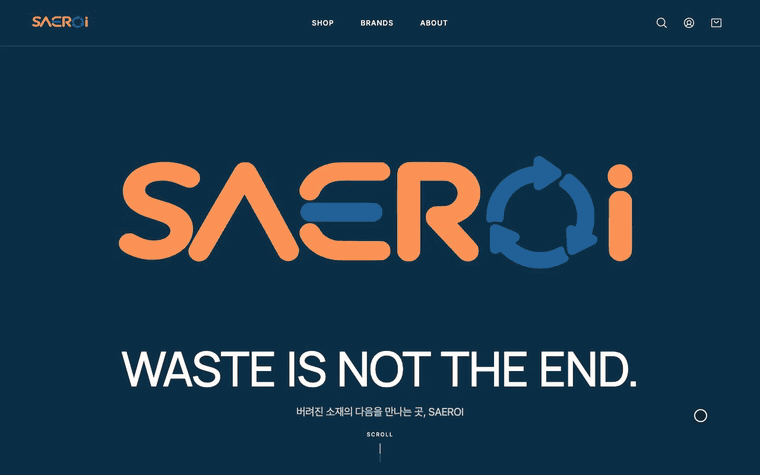
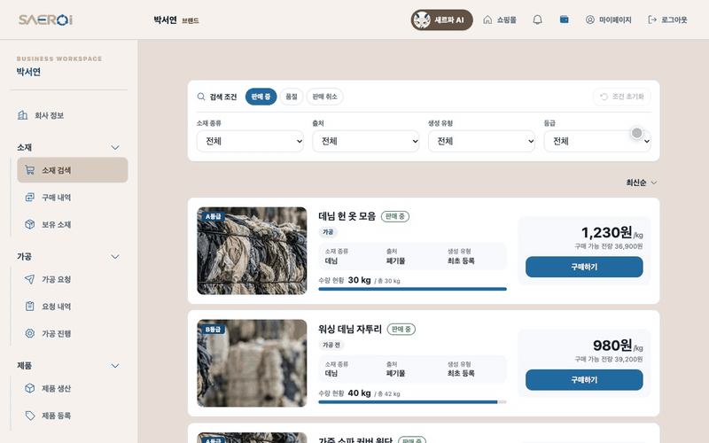
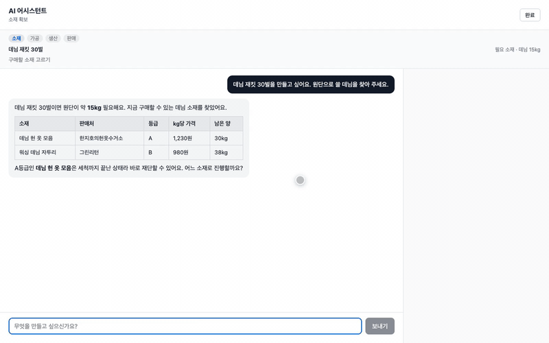
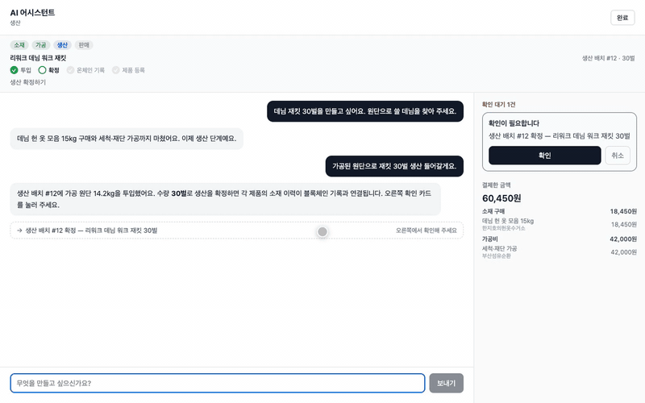
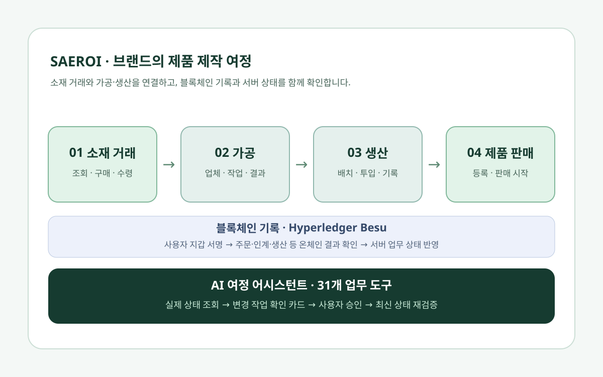
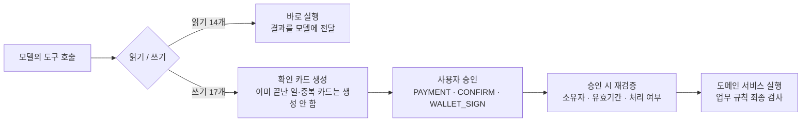

# 새로이(SAEROI) · 블록체인 기반 업사이클링 플랫폼

> 폐소재 공급업체·가공업체·브랜드를 연결해 버려진 소재를 새로운 제품으로 이어가는 업사이클링 플랫폼입니다.
> 주문·인계·생산 기록은 Hyperledger Besu에 남기고, 브랜드 담당자는 AI 여정 어시스턴트와 대화하며 소재 구매부터 생산·판매까지 진행합니다.



<sub>프로젝트 종료 후 시연용 데이터를 넣어 녹화한 화면입니다.</sub>

| 기간 | 팀 구성 | 내 역할 | 수상 |
| --- | --- | --- | --- |
| 2026.08 ~ 2026.09 | 6인 팀 (삼성청년 SW·AI 아카데미) | Material–Brand 소재 거래, 브랜드 AI 여정 어시스턴트 백엔드·프론트엔드 | 삼성청년 SW·AI 아카데미 프로젝트 우수상 |

**링크** · [포트폴리오 상세](https://portfolio-sys13-9a4d.vercel.app/projects/saeroi) · [팀 설계 문서](docs/PROJECT_DESIGN.md) · [Git 컨벤션](GIT_CONVENTION.md)

## 주요 기능

굵게 표시한 항목이 본인이 맡은 영역입니다. 나머지는 팀원들이 구현한 기능입니다.

| 영역 | 내용 |
| --- | --- |
| 소재 등록 | 저울 사진 OCR로 무게를 인식해 소재를 등록하고, 증빙 해시와 함께 ERC-1155 Material Token을 발행 |
| **소재 거래 (공동 구현)** | 공급업체의 판매 등록, 브랜드의 검색·구매, 카카오페이 결제, 발송·수령 확인. 수령 시 온체인에서 소재 소유권 이전 |
| 가공 | 가공업체 검색·요청, 가공비 결제, 소재 인계, 가공 결과 승인 |
| 생산 | 생산 배치 생성, 가공 소재 투입, 생산 확정과 온체인 기록 |
| 제품 판매 | 제품 등록, 쇼핑몰, 장바구니·주문 결제 |
| QR Passport | 로그인 없이 제품의 소재 이력(Journey)을 공개 조회 |
| 판매량 예측 | 확정된 생산 배치의 판매량 구간을 포인트로 예측하는 예측시장 |
| **브랜드 AI 여정 어시스턴트** | 대화 하나로 소재 구매부터 가공·생산·판매까지 진행. 상태를 바꾸는 작업은 확인 카드 승인 후에만 실행 |

결제·환불·정산은 백엔드와 DB에서 처리하고, 블록체인에는 금액이나 결제 식별자를 기록하지 않습니다.

## 내가 맡은 부분

`backend/`와 `frontend/`의 소재 거래·AI 어시스턴트 코드와 `deploy/`의 에이전트 LLM 환경변수 설정을 맡았습니다.

### 1. Material–Brand 소재 거래 (공동 구현)

거래 엔티티와 발송·수령 API는 팀원이 먼저 만들었고, 그 위에 판매·구매·결제 흐름과 화면을 구현했습니다.

- 판매 등록·검색·판매 취소 API — [ListingController](backend/src/main/java/com/ssafy/upcycle/trade/controller/ListingController.java)
- 구매·결제·거래 취소 API — [TradeController](backend/src/main/java/com/ssafy/upcycle/trade/controller/TradeController.java), [TradeCommandService](backend/src/main/java/com/ssafy/upcycle/trade/service/TradeCommandService.java)(구매), [PaymentService](backend/src/main/java/com/ssafy/upcycle/trade/service/PaymentService.java)(결제 준비·승인·취소)
- 카카오페이 2단계 결제(준비 → 승인) 연동, 결제 금액은 요청값이 아니라 서버가 계산 — [KakaoPayGateway](backend/src/main/java/com/ssafy/upcycle/trade/payment/KakaoPayGateway.java), [TradePricing](backend/src/main/java/com/ssafy/upcycle/trade/service/TradePricing.java)
- 판매 글 검색을 QueryDSL로 옮기고 조합 필터 테스트 작성 — [ListingSearchQueryRepository](backend/src/main/java/com/ssafy/upcycle/trade/repository/ListingSearchQueryRepository.java)
- 결제하지 않고 이탈한 거래를 배치로 정리 — [MaterialTradeExpiryWorker](backend/src/main/java/com/ssafy/upcycle/trade/service/MaterialTradeExpiryWorker.java)
- 지갑 서명 후 트랜잭션 결과를 서버 거래 상태와 연결하는 경로, 취소된 거래의 온체인 예약 해제 — [TradeChainLinkService](backend/src/main/java/com/ssafy/upcycle/trade/service/TradeChainLinkService.java), [useOnChainLink](frontend/src/hooks/useOnChainLink.ts), [TradeChainReleaseButton](frontend/src/features/trade/components/TradeChainReleaseButton.tsx)
- 공급업체 판매 관리, 브랜드 소재 검색, 거래 상세 화면 — [features/supplier](frontend/src/features/supplier), [features/marketplace](frontend/src/features/marketplace), [features/trade](frontend/src/features/trade)



<sub>브랜드 소재 검색 — 프로젝트 종료 후 시연용 데이터를 넣어 녹화한 화면</sub>

### 2. 브랜드 AI 여정 어시스턴트

브랜드 담당자가 한 대화에서 현재 상태와 다음 할 일을 확인하고, 필요한 작업을 승인하며 제품 제작을 이어가도록 만들었습니다.

- **업무 도구 31개**: 기존 도메인 서비스를 감싼 도구 29개(소재 검색·구매·수령, 가공 요청·결제·인계·결과 승인, 생산 배치·투입·확정, 제품 등록·판매)와 대화 상태 도구 2개(요구사항 저장, 여정 단계 이동) — [agent/tool](backend/src/main/java/com/ssafy/upcycle/agent/tool)
- **승인형 실행**: 읽기 도구 14개(조회 12개, 대화 상태 2개)는 바로 실행하고, 쓰기 도구 17개는 결제(PAYMENT)·확인(CONFIRM)·지갑 서명(WALLET_SIGN) 카드를 만들 뿐 직접 실행하지 않음 — [PendingActionKind](backend/src/main/java/com/ssafy/upcycle/agent/tool/PendingActionKind.java), [AgentToolExecutor](backend/src/main/java/com/ssafy/upcycle/agent/service/AgentToolExecutor.java)
- **진행 상태와 후속 작업**: 완료된 거래·가공·생산·제품의 연결을 서버에서 따라가 남은 일과 상대 업체를 기다리는 단계를 구분하고, 인자가 확정된 후속 작업만 서버가 자동으로 카드를 띄움 — [BrandStepResolver](backend/src/main/java/com/ssafy/upcycle/agent/service/step/BrandStepResolver.java), [BrandStepAutoProposer](backend/src/main/java/com/ssafy/upcycle/agent/service/step/BrandStepAutoProposer.java)
- **대화 화면**: 대화창, 진행 막대, 할 일 패널, 결제·확인·지갑 서명 카드 — [AgentChat](frontend/src/features/agent/components/AgentChat.tsx), [AgentTaskPanel](frontend/src/features/agent/components/AgentTaskPanel.tsx), [WalletSignCard](frontend/src/features/agent/components/WalletSignCard.tsx)
- 대화별로 모델 턴이 한 번에 하나만 돌도록 직렬화 — [ConversationTurns](backend/src/main/java/com/ssafy/upcycle/agent/service/ConversationTurns.java)

> 대화별 동시 처리 제어는 현재 단일 서버 인스턴스의 메모리 잠금을 사용합니다. 다중 인스턴스로 운영하려면 분산 조정이 필요합니다.

| 소재 구매 결제 카드 | 생산 확정 승인 |
| --- | --- |
|  |  |

<sub>두 화면 모두 프로젝트 종료 후 시연용 데이터를 넣어 녹화했습니다.</sub>

## 문제 해결

### 오래된 대화 정보가 실제 작업으로 이어지는 문제

- **문제**: 결제 이후에도 모델이 결제 이전 상태로 답하거나, 확인 카드의 번호(`cardId`)를 생산 배치 번호처럼 사용하는 사례가 있었습니다. 대화의 문장만으로 거래·재고·생산 상태를 판단하면 정보가 오래될 수 있었습니다.
- **해결**
  - 매 턴 서버가 거래·가공·생산 상태를 다시 읽어 기본 프롬프트와 분리된 두 번째 system 메시지로 넣고, 그 뒤에 대화 이력을 붙였습니다 — [AgentTurnStore.loadPrompt](backend/src/main/java/com/ssafy/upcycle/agent/service/AgentTurnStore.java)
  - 카드의 수량·금액·제목은 모델이 만든 값이 아니라 서버 조회값으로 구성했습니다.
  - 남은 일 판정은 [BrandStepResolver](backend/src/main/java/com/ssafy/upcycle/agent/service/step/BrandStepResolver.java) 한 곳에서 하고, 대화([AgentPendingWork](backend/src/main/java/com/ssafy/upcycle/agent/service/AgentPendingWork.java))와 진행 패널([AgentJourneyProgress](backend/src/main/java/com/ssafy/upcycle/agent/service/AgentJourneyProgress.java))이 같은 판정을 쓰도록 연결했습니다.
- **결과**: 모델의 기억 대신 서버 상태를 기준으로 다음 작업을 판단합니다. 이 동작을 테스트 `막힌_단계는_매_턴_시스템_프롬프트로_들어간다`([AgentEventStateTests](backend/src/test/java/com/ssafy/upcycle/agent/AgentEventStateTests.java))로 작성했습니다. 실제 운영 환경의 오류율 감소 수치는 측정하지 않았습니다.

### 오래되거나 중복된 확인 카드의 실행 방지

- **문제**: 카드를 열어 둔 사이 다른 화면에서 작업이 완료되거나, 같은 대상에 확인 카드가 여러 장 생길 수 있었습니다.
- **해결**
  - 카드 생성 전: 이미 완료된 작업인지 확인하고, 같은 도구·대상의 카드가 열려 있으면 새로 만들지 않고 기존 카드를 안내합니다 — [AgentToolExecutor](backend/src/main/java/com/ssafy/upcycle/agent/service/AgentToolExecutor.java), [OpenCards](backend/src/main/java/com/ssafy/upcycle/agent/service/OpenCards.java)
  - 승인 시: 대화 소유자·카드 유효기간·이미 처리된 작업인지를 다시 확인한 뒤 실행하고, 나머지 업무 규칙은 도메인 서비스가 검사합니다 — [AgentActionStore](backend/src/main/java/com/ssafy/upcycle/agent/service/AgentActionStore.java)
  - 방금 끝난 지갑 서명은 승인 요청에 트랜잭션 해시가 함께 와서, 자기 카드를 '이미 처리됨'으로 오판하지 않게 했습니다.
- **결과**: 모델은 결제·지갑 서명·생산 확정을 직접 실행할 수 없고, 승인 시점의 서버 상태를 다시 확인합니다. 경계 사례는 다음 테스트로 작성했습니다.
  - [AgentChatServiceTests](backend/src/test/java/com/ssafy/upcycle/agent/AgentChatServiceTests.java): `쓰기_tool_은_실행되지_않고_확인_카드만_만든다`
  - [AgentStaleActionTests](backend/src/test/java/com/ssafy/upcycle/agent/AgentStaleActionTests.java): `카드를_만든_뒤_화면에서_먼저_처리했으면_승인해도_실행되지_않는다`, `방금_한_서명이_자기_카드를_이미_처리됨으로_닫지_않는다`
  - [PendingActionServiceTests](backend/src/test/java/com/ssafy/upcycle/agent/PendingActionServiceTests.java): `같은_액션을_두_번_승인할_수_없다`, `남의_액션은_건드릴_수_없다`
  - [BrandStepAutoProposeTests](backend/src/test/java/com/ssafy/upcycle/agent/BrandStepAutoProposeTests.java): `자동으로_띄운_카드를_모델이_또_띄우지_못한다`

### 동시 구매로 판매 수량을 초과하는 문제

- **문제**: 잔여 12kg인 판매 글을 두 사람이 동시에 10kg씩 사면, 둘 다 "12kg 남음"을 읽고 검사를 통과해 잔여가 음수가 되고, 나중 한 건이 DB 제약 위반으로 설명 없는 500 오류가 됩니다.
- **해결**: 구매·취소 직전에 판매 글을 행 잠금(`PESSIMISTIC_WRITE`)으로 읽어, 두 번째 요청이 줄어든 잔여를 보고 도메인 오류로 거절되게 했습니다. 재시도 루프가 필요한 낙관적 락 대신 짧은 단일 행 잠금을 택했습니다 — [ListingLockRepository](backend/src/main/java/com/ssafy/upcycle/trade/repository/ListingLockRepository.java)
- **결과**: 두 구매자가 같은 판매 글을 동시에 구매하는 상황을 [ConcurrentPurchaseTests](backend/src/test/java/com/ssafy/upcycle/trade/service/ConcurrentPurchaseTests.java)로 작성했습니다.

## 기술 스택

| 구분 | 기술 |
| --- | --- |
| Backend | Java 21, Spring Boot 3.5, Spring Data JPA, QueryDSL, Spring Security(OAuth2 Resource Server), Web3j, Maven |
| Frontend | React 19, TypeScript, Vite, TanStack Query, Zustand, React Hook Form, React Router, ethers.js 6, Vitest |
| Blockchain | Solidity 0.8.24, Hardhat, OpenZeppelin(ERC-1155, AccessControl), Hyperledger Besu(SSAFY 네트워크) |
| AI | LLM Tool Use(SSAFY GMS API), FastAPI, RapidOCR(ONNX Runtime), OpenCV |
| Data | MySQL 8, 파일 저장소(로컬 볼륨 또는 S3 호환 MinIO) |
| Infra | Docker Compose, Nginx, Jenkins, AWS EC2 |
| 결제 | 카카오페이 |

## 아키텍처



- Nginx가 `/`는 React 앱으로, `/api`는 Spring Boot로 전달합니다. Spring Boot는 MySQL, 파일 저장소, FastAPI OCR 서버, Besu(Web3j)를 사용하고, AI 어시스턴트의 LLM 호출도 백엔드에서만 이뤄집니다.
- MySQL은 업무 데이터와 현재 상태, 대화 이력과 승인 대기 작업을 관리하고, Besu는 주문·인계·생산 등의 블록체인 기록을 맡습니다.
- 사용자 서명이 필요한 작업은 브라우저에서 MetaMask로 서명하고, 서버가 트랜잭션 결과를 받아 업무 상태에 반영합니다.

AI 도구 호출이 실제 작업이 되기까지의 흐름은 다음과 같습니다.



## 실행 방법

필요 환경: Java 21, Node.js `^20.19.0` 또는 `>=22.12.0`, Python 3.12, MySQL 8, MetaMask

아래 명령은 모두 저장소 루트에서 시작하며, 서버(백엔드·프론트엔드·AI)는 각각 별도 터미널에서 실행합니다.

**백엔드** — `application-local.yml.example`을 복사해 값을 채운 뒤 실행

```bash
cd backend
cp src/main/resources/application-local.yml.example src/main/resources/application-local.yml
./mvnw spring-boot:run -Dspring-boot.run.profiles=local
./mvnw test
```

**프론트엔드** — http://localhost:5173, `/api` 요청은 로컬 백엔드로 프록시

```bash
cd frontend
cp .env.example .env
npm install
npm run dev
npm run test
```

**AI OCR 서버** — 기본 포트 8000

```bash
cd ai
python -m pip install -r requirements.txt
python -m uvicorn app.main:app --host 0.0.0.0 --port 8000
```

**스마트 컨트랙트**

```bash
cd blockchain
npm install
npm run compile
npm test
```

- 백엔드 주요 환경변수: `DB_URL`, `DB_USERNAME`, `DB_PASSWORD`, `JWT_SECRET`, `AI_SERVER_BASE_URL`, `BESU_RPC_URL`, `BESU_CHAIN_ID`, `MATERIAL_TOKEN_ADDRESS`, `MARKETPLACE_ADDRESS`, `PROCESSING_REGISTRY_ADDRESS`, `PRODUCTION_REGISTRY_ADDRESS`, `KAKAOPAY_SECRET_KEY`, `KAKAOPAY_CID`, `AGENT_LLM_API_KEY`, `AGENT_LLM_MODEL` (전체 목록은 [application.yml](backend/src/main/resources/application.yml)의 `${...}` 항목, 배포용 값은 [deploy/.env.example](deploy/.env.example))
- `AGENT_LLM_API_KEY`가 비어 있어도 서버는 기동되며, 에이전트 API만 503을 반환합니다.
- 프론트엔드는 `VITE_API_BASE_URL`, `VITE_BESU_RPC_URL`, `VITE_BESU_CHAIN_ID`와 컨트랙트 주소(`VITE_*_CONTRACT_ADDRESS`)를 사용합니다. `VITE_` 값은 번들에 포함되므로 비밀값을 넣지 않습니다.
- 배포 구성(Nginx, MySQL, MinIO, Jenkins)은 [deploy/README.md](deploy/README.md)를 참고합니다. 로컬에서는 placeholder 이미지로 프록시·네트워크·볼륨 구성만 검증할 수 있습니다.

```bash
cd deploy
cp .env.example .env
docker compose -f docker-compose.yml -f docker-compose.local.yml up -d --build
```

## 폴더 구조

```text
saeroi/
├── backend/      Spring Boot API — 소재·거래·가공·생산·제품·QR, 브랜드 AI 어시스턴트
├── frontend/     React 웹 — 쇼핑몰, 업무 공간, AI 어시스턴트, 지갑 서명
├── blockchain/   Solidity 컨트랙트, Hardhat 테스트·배포 스크립트
├── ai/           FastAPI OCR 서버 — 저울 사진 무게 인식
├── deploy/       Docker Compose, Nginx, Jenkins, 배포 스크립트
└── docs/         팀 설계 문서, README 이미지
```

| 폴더 | 원래 브랜치 |
| --- | --- |
| [`backend/`](backend) | `backend/master` |
| [`frontend/`](frontend) | `frontend/develop` |
| [`blockchain/`](blockchain) | `blockchain/master` |
| [`ai/`](ai) | `ai/master` |
| [`deploy/`](deploy) | `deploy/master` |

[docs/PROJECT_DESIGN.md](docs/PROJECT_DESIGN.md)는 팀이 개발 초기에 작성한 설계 문서입니다. 본문의 `backend/master` 같은 브랜치 이름은 같은 이름의 폴더를 가리키며, 일부 내용은 최종 구현과 다릅니다(예: Escrow 컨트랙트 없이 결제는 카카오페이와 DB에서 처리, 백엔드 빌드는 Maven).
